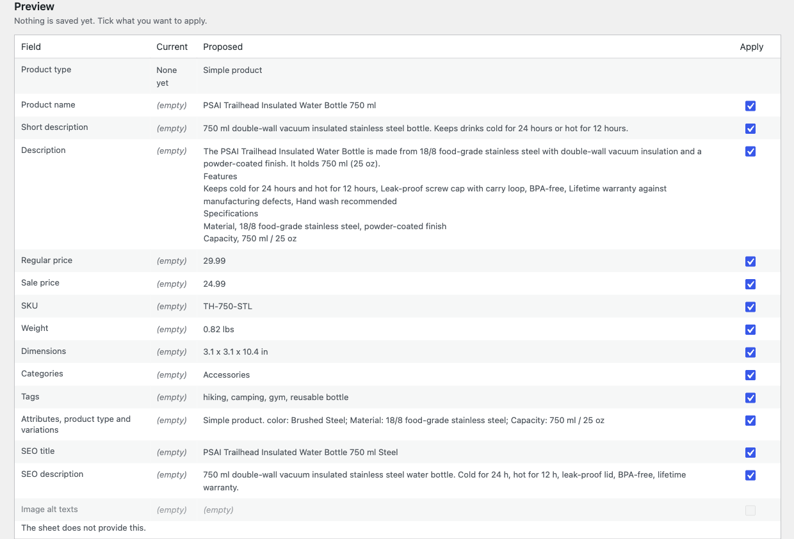
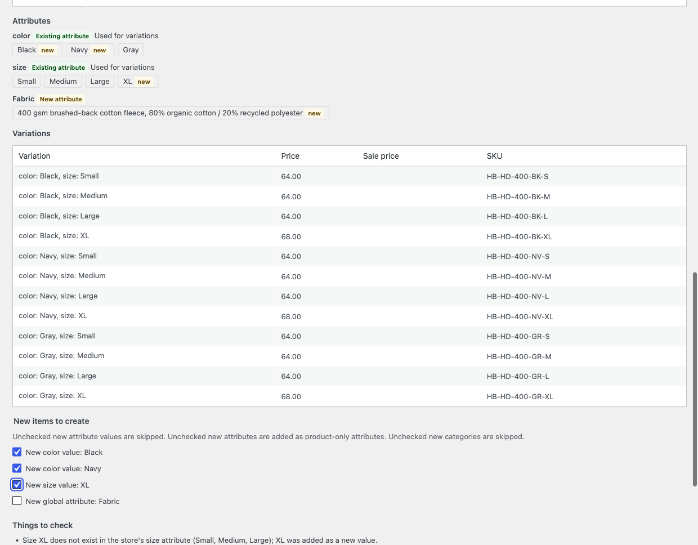
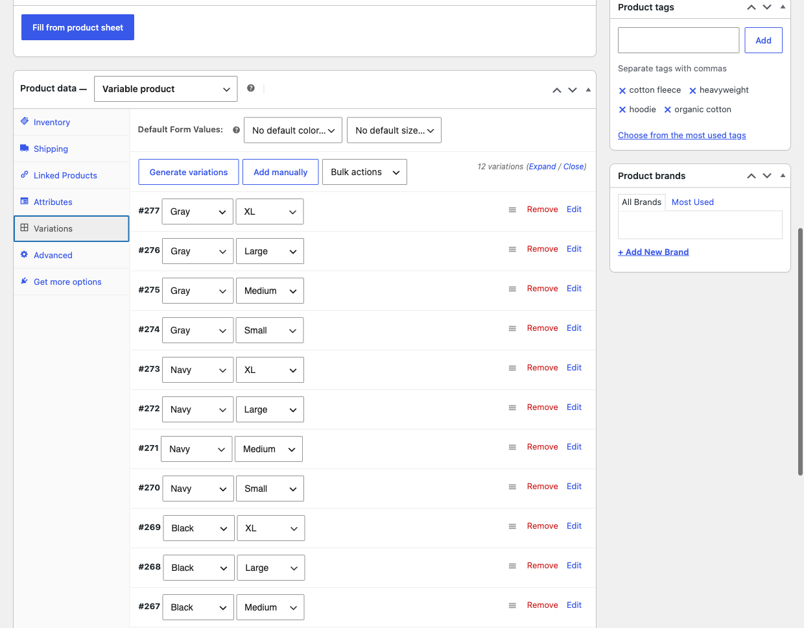

# Product Sheet AI for WooCommerce: fill products from a supplier sheet

Product Sheet AI is a free WordPress plugin that turns a supplier sheet into a WooCommerce product draft. Paste the text or a table, or upload a CSV or a PDF with a text layer, and it fills in the name, descriptions, attributes, variations, prices, SKU, weight, categories, tags, SEO texts and image alt texts.

You stay in control. Every field shows the current value next to the proposed one, with a checkbox, and nothing is saved until you apply. New products are always drafts. It uses the attributes and categories your store already has, and asks before creating new ones. You bring your own Anthropic key, or any OpenAI-compatible service.

## What you get

- Paste a sheet or upload .txt, .csv or a text PDF
- Name, short and long description, attributes, variations, prices, SKU, weight and dimensions
- Categories, tags, SEO title and description, image alt texts
- Current vs proposed value for every field, with a checkbox
- New products saved as drafts, never published
- Matches your existing global attributes; new values only after you confirm
- Works with Yoast SEO and Rank Math
- Request log with tokens and approximate cost, usually a cent or two per product
- Your own key: Anthropic by default, or any OpenAI-compatible endpoint

## Need this for your store?

Need this for your store, or a custom import? Tell me about your catalog and I will tell you what is possible and what it costs.

[Tell me about your catalog](https://helpmybiz.org)

## Links

- Source: https://github.com/andrewrozumny/product-sheet-ai-for-woocommerce
- WordPress.org: https://wordpress.org/plugins/product-sheet-ai-for-woocommerce/
